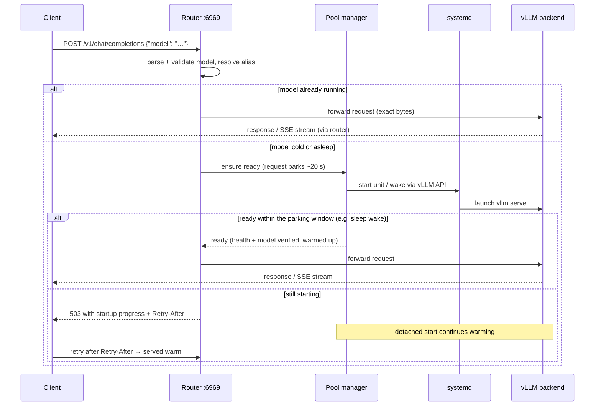

# vLLM Pooling Router

A model-routing gateway that lets a small pool of GPUs serve a large catalog of models
through vLLM's native API surface — OpenAI-compatible chat/completions/embeddings,
Anthropic's Messages API, and Cohere/Jina-style scoring and rerank. Clients send an
ordinary request (say `POST /v1/chat/completions` or `POST /v1/messages`) naming any
configured model; the router forwards to the vLLM server that serves it — and if that
model isn't running, the router **starts (or wakes) it on demand**: requests are held
briefly (~20 s by default) so fast wakes succeed transparently, and a true cold start
returns a progress-reporting 503 with an honest `Retry-After` while the model warms in
the background — the retry lands warm. Idle models are put to sleep or stopped
automatically so the GPUs are always available for what's actually being used.

## Why it exists

GPUs are scarce and models are many. Running one vLLM server per model wastes VRAM on
models nobody is querying; manually starting and stopping servers turns every model
switch into an ops task. This router makes the pool self-service:

- **One endpoint, many models.** Clients only know the router's address and a model name.
- **Scale-from-zero.** First request for a cold model triggers the start; fast wakes
  answer transparently, slow cold starts answer with visible progress and a warm retry
  instead of a silent hang.
- **GPU arbitration.** One awake owner per GPU, priority-then-LRU eviction when demand
  needs a busy GPU, declared VRAM/RAM budgets validated up front.
- **Sleep mode aware.** Where validated, vLLM's two sleep levels replace full restarts —
  offloading weights to host RAM (L1) or discarding them (L2) to hand the GPU back while
  the process stays alive, so returning costs seconds instead of a multi-minute cold
  start. See [the lifecycle section](#first-the-vocabulary-sleep-l1-and-l2).
- **Streams are sacred.** SSE token streams pass through chunk-by-chunk, are never
  buffered or compressed, and long generations are bounded by an *inter-token* idle
  timeout rather than a total duration limit.

The router never becomes a single point of failure for running models: vLLM processes
are owned by systemd, not the router. Restarting or upgrading the router leaves every
model serving.

## How a request flows



## Model lifecycle: what starts, sleeps, and stops a model

Nothing runs until something asks for it, and nothing stays running forever. Four
mechanisms decide residency, and every state change on a model traces back to exactly
one of them.

### First, the vocabulary: sleep, L1, and L2

A loaded model holds its full VRAM reservation even when nobody is using it — about 31 GB
per GPU in the reference configuration. Without sleep the only choices are to keep it
(blocking the GPU) or stop the process (paying a full cold start to come back).

**Sleep is the middle option: keep the backend process alive, hand the GPU memory back.**
It is a vLLM feature, not a router invention. The generator enables it with the
`--enable-sleep-mode` launch flag, which exposes `POST /sleep?level=N` and
`POST /wake_up` on the backend; `L1` and `L2` are this project's names for vLLM's two
sleep levels, written `l1` and `l2` in configuration.

- **L1 — weights move to host RAM.** Weights are copied out of VRAM into system RAM and
  the KV cache is dropped; the process keeps holding those weights. Waking copies them
  back: a single `POST /wake_up`. This is why `sleep.l1_host_ram_bytes` exists and why it
  is required for L1 only.
- **L2 — weights are discarded.** Nothing is retained in host RAM, so waking must re-read
  the weights from disk. That is why the router's L2 wake is three calls rather than one:
  `/wake_up?tags=weights`, a `collective_rpc` `reload_weights`, then `/wake_up?tags=kv_cache`.

The trade, from the per-model measurements in `docs/`:

| | L1 | L2 | Stopped |
|---|---|---|---|
| Weights held in | host RAM | nowhere — reloaded from disk | nowhere |
| Host RAM cost | large — 39 GB measured for the 27B | none | none |
| Wake, Qwen3.6-27B NVFP4 | ~3.03 s | ~5.05 s | minutes (full cold start) |
| Wake, Llama-3.1-8B FP8 (TP=1) | ~0.27 s | ~3.10 s | minutes (full cold start) |

Two measured properties that are easy to get wrong:

- **Sleeping does not empty the GPU.** Roughly 1,414 MiB stays resident for the 27B and
  944 MiB for Llama-8B. That residue is what `sleep.residual_vram_bytes_per_gpu` declares,
  and the router uses it as the expected VRAM for a sleeping service. Enough headroom is
  freed for another model to take the card; the card is not free.
- **A sleeping backend does not refuse traffic, it stalls.** Every direct request to a
  sleeping model in both validation runs was accepted and then returned no bytes before
  the client timed out. The router therefore refuses on its own freshness facts and wakes
  before forwarding, rather than treating the backend as a safety barrier.

### 1. Demand starts a model

A model is started only by an inference request naming it, or by an explicit
`POST /pool/v1/services/{name}/start`. There is no "desired state = running" reconciler:
`enabled: true` and `automatic_start: true` mean *may be started on demand*, not *keep
running*. A fleet at rest reports every service `stopped`, and that is the healthy state.

A demand-driven start parks the request while the backend comes up. If the model is not
ready within `parking.deadline_ms` (default 20 s), the client gets `503` +
`Retry-After` — **and the start continues in the background**, detached from the request
that triggered it. That is deliberate: the retry lands warm. The consequence to know is
that a failed request can leave a model resident.

### 2. Placement: one awake owner per GPU

Services declare `gpu_ids`. Two services whose GPU sets overlap cannot both be awake.
Before a model starts, the router looks for an *awake owner* of any GPU it needs.
`stopped`, `drained`, `asleep_l1`, and `asleep_l2` do not own placement; every other
state does — including `failed`, `stale`, and `unknown`, which fail closed. A label that
disagrees with reality also fails closed: a service labelled `stopped` whose systemd unit
is still active keeps its placement.

**A sleeping model releases its GPU.** That is the whole point of sleep, and the reason
it is the better idle tier when it is available.

### 3. Eviction: only with `evict`, and never a busy model

When a start needs an occupied GPU, it displaces the owner only if the caller passed
`evict` — which the data plane always does, and the control API does only when asked.
Candidates are ordered:

1. **lowest `priority` first**,
2. then **longest idle** (LRU),
3. then name, for determinism.

A model is evictable only if `evictable: true`, it has **zero active and zero parked
requests**, and it is not mid-transition. A busy model is never displaced — the incoming
start waits, then fails with `placement_unavailable` at its deadline. Eviction issues a
**non-force stop**, so it never kills in-flight work.

### 4. The idle reaper: three tiers, in a fixed order

Every observation tick, each service with no active and no parked requests is checked
against `idle`. Thresholds are milliseconds of continuous idleness, and the **first
matching rule wins**:

| Order | Setting | Fires when | Action |
|---|---|---|---|
| 1 | `stop_after_ms` | idle ≥ threshold, from `running`, `drained`, **or either asleep state** | stop the unit — frees VRAM *and* host RAM |
| 2 | `sleep_l2_after_ms` | already `asleep_l1` and idle ≥ threshold | deepen to L2 — discards weights, keeps the process |
| 3 | `sleep_l1_after_ms` | `running` and idle ≥ threshold | sleep to L1 — offloads weights to host RAM |

Because rule 1 is checked first and applies to sleeping models too, `stop_after_ms` is a
ceiling on total residency, not an alternative to sleep. The intended shape is a ladder —
sleep early, stop eventually — which the validator enforces:
`sleep_l1_after_ms < sleep_l2_after_ms < stop_after_ms`, each greater than zero.

**Default when `idle` is omitted: `stop_after_ms: 3_600_000` (1 h), no sleep tiers.**

### Why your models stop instead of sleeping

Sleep is fully implemented but **off by default**, and it stays off until a service opts
in. `sleep.enabled: true` is rejected by `-t` unless the service also sets
`hardware_validated: true`, a non-empty `levels`, a non-zero `residual_vram_bytes_per_gpu`,
and — for L1 — an `l1_host_ram_bytes` at or above the measured
`compatibility.minimum_l1_host_ram_bytes`. Conversely, if `sleep.enabled` is false, every
sleep field and both sleep thresholds must be unset; a stray `sleep_l1_after_ms` is a
config error, not a silent no-op.

That gate exists because sleep residency is a per-host, per-model measurement: vLLM's L1
sleep leaves residual VRAM behind and needs enough host RAM to hold the offloaded weights.
Guessing those numbers over-commits a GPU. So a service with sleep unconfigured has
exactly one idle tier available — `stop_after_ms` — and the reaper takes it.

**How a value is earned.** `hardware_validated: true` asserts that someone put this model
to sleep and woke it repeatedly on this machine, and wrote down what it cost. It is
specific to the exact checkpoint, vLLM version, host, and tensor-parallel degree, because
any of those can change the answer.

The procedure, run separately for each combination of tensor-parallel degree,
quantization, and sleep level:

1. **Sleep and wake it five times**, sending the same prompt after every wake and checking
   the output is still identical. A model that wakes subtly broken is the failure this
   catches.
2. **Time each wake.** This is the number that decides whether sleep is worth its cost at
   all.
3. **Read the VRAM still held while asleep** (`nvidia-smi`) → `residual_vram_bytes_per_gpu`.
4. **Read the host RAM held while asleep** — the systemd unit's `MemoryCurrent` — and
   compare it against the budget you declared. This is the step both models on this host
   failed.
5. **Send a request to the sleeping model** and record what actually happens, rather than
   assuming it returns an error.
6. **Check sleep respects in-flight work**: it must drain first, and must refuse to sleep
   mid-request.
7. **Exercise the L2 wake sequence and the L1→L2 promotion**, since those paths only run
   in specific transitions and are otherwise untested.

Write the results into `docs/{model-id}.md`; the step-by-step drill lives in
`features/2026-07-28-pooling/testing-runbook.md`. Only a combination that passes all of it
may set `hardware_validated: true`.

Note which of these fields is a claim and which is a measurement:

| Field | Kind | Source |
|---|---|---|
| `sleep.l1_host_ram_bytes` | your declared budget | you write it; step 4 tests whether it held |
| `compatibility.minimum_l1_host_ram_bytes` | measured floor | max observed `MemoryCurrent`, rounded up with margin |
| `sleep.residual_vram_bytes_per_gpu` | measured | VRAM still held while asleep |

Validation rejects a declared budget below the measured floor, and the floor is recorded
**even when sleep stays disabled** so a later enablement cannot under-declare. A topology
that fails outright is recorded in `compatibility.unsupported_tensor_parallelism`, which
makes configuration validation reject that degree until the cell is revalidated.

Both models measured on this host so far — `docs/qwen3.6-27b-nvfp4.md` and
`docs/meta-llama-3.1-8b-instruct-fp8.md` — failed eligibility the same way: measured L1
host-RAM use exceeded the declared budget (39.0 GB against 30 GB, and 24.53 GB against
20 GB). In both cases the sleep mechanism itself worked; the budget declaration did not.
That is the expected failure mode, and the reason the floor is recorded before sleep is
ever switched on.

**Sleep is better than stop for a model you return to**, and the difference is large: an
L1 wake is a `/wake_up` call against a live process, well inside the 20 s parking window,
so the request that triggers it is usually served without ever seeing a `503`. A cold
start reloads weights from disk and takes minutes. Trading host RAM for that is usually
the right call on a workstation.

### Worked examples

**A cold model on first use, and why a `503` still leaves it running.** You send a request
to a stopped model. The router parks it, starts the unit, and the load exceeds the 20 s
window, so you get `503` with `Retry-After: 120`. You never retry. Ten minutes later
`just pool` shows it `running` with zero requests served — the detached start finished
without you. Nothing is wrong: it will reap itself at `stop_after_ms`. To confirm this is
what happened rather than a phantom start, look for a transition with no matching audit
record:

```console
curl -s :6971/metrics | grep -E 'transitions_total|admission_rejections_total'
# vllm_router_transitions_total{service="qwen35b",transition="ensure_ready",result="success"} 1
# vllm_router_admission_rejections_total{service="qwen35b",reason="parking_expired"} 1
```

A start plus a `parking_expired` on the same service is demand-driven warming from a
request that gave up.

**A whole fleet found stopped after an hour away.** Every service here uses the default
single tier, so an hour of idleness stops each one and the next request pays a full cold
start. To make returns cheap, give the service a sleep ladder — offload after 10 minutes,
deepen at 30, release the host entirely at 4 hours. Shown with the values actually
measured for Qwen3.6-27B NVFP4 rather than invented ones, since every number here has to
come from an actual sleep/wake run on this host:

```yaml
  sleep:
    enabled: true
    hardware_validated: true          # only after measuring it, per the steps above
    levels: [l1, l2]
    residual_vram_bytes_per_gpu: 1482686464   # 1,414 MiB measured while asleep
    l1_host_ram_bytes: 40000000000            # ≥ minimum_l1_host_ram_bytes
  idle:
    sleep_l1_after_ms: 600000         # 10 min → weights to host RAM
    sleep_l2_after_ms: 1800000        # 30 min → discard weights, keep process
    stop_after_ms: 14400000           #  4 h   → release the unit entirely
```

Validate before restarting — the router applies configuration only at startup:

```console
vllm-router -t -c /etc/vllm-router/pingora.yaml --router-config /etc/vllm-router/router.yaml
```

This exact service is **not** currently eligible: its 2026-07-29 run measured 39.0 GB of
L1 host RAM against a 30 GB declaration, so `hardware_validated: true` would be a false
claim until a re-run passes against the 40 GB floor. Until that is honestly earned, the
safer change is simply raising `stop_after_ms`. Note that a sleeping model still occupies
host RAM and `residual_vram_bytes_per_gpu`, so sleep trades memory for latency — it is
not free.

**A model that vanished while another started.** Two services sharing `gpu-0`: `low`
(`priority: -100`, idle 40 min) and `high` (`priority: 100`, idle 2 min). A request
arrives for a third service on the same GPU. The data plane always evicts, so the router
sorts candidates by priority first and stops `low` — idle time only breaks ties within a
priority. Had `low` been serving even one request, it would have been skipped entirely and
the incoming start would have failed with `placement_unavailable` at its deadline rather
than interrupting work. Eviction is recorded distinctly from an idle reap:

```console
curl -s :6971/metrics | grep transitions_total
# vllm_router_transitions_total{service="low",transition="evict",result="success"} 1
```

`transition="evict"` means something displaced it; `transition="stop"` means it idled out
or an operator stopped it.

## Requirements

- Linux with systemd (the router controls model units over D-Bus).
- vLLM ≥ 0.26 installed on the host with its models on local disk.
- NVIDIA driver/NVML visible to the router for GPU observation.
- Rust ≥ 1.85 and [`just`](https://github.com/casey/just) to build.

## Install

```console
just build                      # optimized binary in target/release/
just install --root /usr/local  # or: cargo install --path . --root /usr/local
```

Then lay down the runtime files:

| Path | Purpose |
|---|---|
| `/etc/vllm-router/pingora.yaml` | server runtime settings (threads, upgrade socket) — start from `deploy/pingora.yaml` |
| `/etc/vllm-router/router.yaml` | GPUs, policies, and service definitions — start from `src/config/example.yaml` |
| `/run/secrets/vllm-router-token` | management bearer token, root-owned, mode `0600` |
| `/run/secrets/vllm-router-inference-token` | inference bearer token, root-owned, mode `0600` — a **separate** secret from the management token |
| `/etc/systemd/system/vllm-router.service` | the router itself — from `deploy/vllm-router.service` |
| `/run/systemd/system/vllm@<name>.service` | **generated by the router at startup** — do not hand-edit; see Operating notes |
| `/etc/vllm/<name>.env` | generated per-model environment file consumed by `vllm@<name>.service` |

The router regenerates each model unit and its mode-`0600` environment file at
startup. Global `environment:` defaults in `router.yaml` are inherited by every
service; a service-level `environment:` map overrides individual values. The schema
allowlists `PATH`, `HF_HOME`, and `VLLM_CACHE_ROOT`. GPU placement variables are
owned by the generator: UUID assignments are translated through NVML to numeric
`CUDA_VISIBLE_DEVICES`, with `CUDA_DEVICE_ORDER=PCI_BUS_ID`.

Tool and reasoning parsers are chat-template-specific, not merely model-family
defaults. Configure `runner_args.tool-call-parser` and
`runner_args.reasoning-parser` using names registered by the installed vLLM version;
the example Qwen template uses `qwen3_xml` and `qwen3`.

Validate everything, then start:

```console
vllm-router -t -c /etc/vllm-router/pingora.yaml --router-config /etc/vllm-router/router.yaml
systemctl daemon-reload
systemctl enable --now vllm-router
```

The `-t` run parses and cross-validates the full configuration (duplicate ports, unknown
GPU UUIDs, impossible parallelism, VRAM/RAM overcommit, unsafe runner arguments) and
exits non-zero with an actionable error if anything is wrong.

It is a *host* check, not only a syntax check: before it can pass, every configured GPU
UUID must be present in this host's live NVML inventory, every unit and environment file
the configuration would generate must render from it, and both bearer-token files must
be readable, root-owned, mode `0600`, and non-empty. A UUID typed the same way in both
`inventory` and `placement` is internally consistent but still fails here, and so does a
token file that has not been created yet — which is the point: `-t` should refuse
whatever the router would refuse at startup. All problems are reported in one run.
Run it on a machine without NVIDIA drivers (a CI container) and it fails saying so; add
`--skip-host-gpu-check` there to validate everything else, which logs a warning that the
GPU UUIDs went unchecked.

### Upgrading a running deployment: the inference token

`listeners.inference_bearer_token_file` is **required**. There is deliberately no
default and no "unauthenticated data plane" setting, so a `router.yaml` written before
this setting existed is now rejected — `-t` exits non-zero with
``listeners: missing field `inference_bearer_token_file` `` — and a router restarted
against that config will not come back up. The running process keeps serving until it is
restarted, which is the window to do these two steps — in this order:

1. **Create the token file.** `just token` mints whichever of the two secrets is
   missing and leaves an existing management token untouched. By hand:

   ```console
   (umask 077 && openssl rand -hex 32 > /run/secrets/vllm-router-inference-token)
   ```

   It must be root-owned and mode `0600`, and it must be a *different file* from the
   management token — validation rejects a config that points both settings at one
   path, because an inference client must never hold a credential that also authorizes
   lifecycle mutations.

2. **Declare it** in the existing `listeners` block of `/etc/vllm-router/router.yaml`:

   ```yaml
   listeners:
     data_plane: "0.0.0.0:6969"
     management: "127.0.0.1:6970"
     metrics: "127.0.0.1:6971"
     management_bearer_token_file: /run/secrets/vllm-router-token
     inference_bearer_token_file: /run/secrets/vllm-router-inference-token   # new
   ```

`-t` covers step 1 as well as step 2: test mode opens both token files before it exits,
so a config naming a token file that does not exist fails with
`cannot read bearer-token file` rather than passing and then failing the restart.
Validate the config, then restart:

```console
vllm-router -t -c /etc/vllm-router/pingora.yaml --router-config /etc/vllm-router/router.yaml
systemctl restart vllm-router
```

Confirm both files are in place before restarting — `test -s` on each, owned by root and
mode `0600`.

After the restart, every data-plane client needs
`Authorization: Bearer <inference token>` — unauthenticated requests, including
`GET /v1/models`, get `401`. Distribute the token to clients before restarting.

## Configuration in one glance

`router.yaml` has three top-level sections — see `src/config/example.yaml` for a
complete, commented service:

- **`listeners`** — three separate binds: `data_plane` (public inference), `management`
  (authenticated control API), `metrics` (Prometheus), plus two bearer-token file paths.
  `management_bearer_token_file` and `inference_bearer_token_file` are both required and
  must point at different files: the data plane is the client-reachable bind and can start,
  wake, and evict GPU residents, so it authenticates too — but an inference client must
  never hold a credential that also authorizes lifecycle mutations. There is deliberately
  no "unauthenticated data plane" setting; a config that omits either path fails to load.
  All three are **required** — the router has no built-in default ports; `:6969`,
  `:6970`, and `:6971` used throughout this document are the example config's
  conventional values. (Deliberately not 8000: that is vLLM's own default port, so a
  manually-launched `vllm serve` would collide with the router's data plane.) There is
  no port flag or env var: ports are validated configuration (collision and loopback
  rules run at `-t` time), changed like any other setting via restart-to-apply. The
  router logs its effective listeners at startup (an info-level `"listeners
  configured"` line carrying all three addresses).

  **Why three listeners instead of one port with routes:** the boundary between them
  is enforced by *bind address*, not application code. The data plane must be
  client-reachable (`0.0.0.0`); management can kill workloads and belongs on
  loopback, unreachable from the network before any code runs; metrics sits apart
  from both because its consumer is a Prometheus scraper whose location can change —
  if monitoring runs on another host, only the metrics bind widens, and neither the
  mutation surface nor its bearer-token auth is dragged along. Separate ports also
  keep router-owned paths structurally disjoint from the proxied vLLM surface (which
  has its own `/metrics`), and give the management API its own service threads so it
  stays responsive while the data plane is saturated — exactly when you need it.
- **`inventory`** — host RAM and each GPU by **stable UUID** (`nvidia-smi -L`) with its
  VRAM capacity. Placement and budget validation are computed against these.
- **`services`** — one entry per model server: served model name + aliases, GPU
  assignment and parallelism, absolute `runner_executable` path, backend loopback port,
  systemd unit, readiness probes, deadlines, idle tiers (`sleep_l1_after_ms` →
  `sleep_l2_after_ms` → `stop_after_ms`), short-parking policy,
  priority/evictability, and
  sleep settings. Sleep stays off unless the service is explicitly marked
  `hardware_validated: true`. Known-bad checkpoint/runtime topologies belong in
  `compatibility.unsupported_tensor_parallelism`; config validation then prevents
  that tensor-parallel degree from being selected. A conservative measured L1
  pinned-RAM floor belongs in `compatibility.minimum_l1_host_ram_bytes`; enabling L1
  requires `sleep.l1_host_ram_bytes` to meet that floor before the aggregate host
  budget is checked. If omitted, `runner_executable` defaults to
  `/opt/vllm-venv/bin/vllm` for compatibility with existing deployments.

## API surface

### Inference (data plane, default `:6969`)

Every request on this listener requires `Authorization: Bearer <inference token>`, checked
in constant time before the request body is read and before any admission, parking,
eviction, or cold start can happen — an unauthenticated caller cannot enumerate models or
move a service between lifecycle states. Missing or wrong credentials get a `401` in the
endpoint's own error dialect. The router's own credential is stripped from the request
before it is forwarded: backends are loopback-bound and hold no matching key.

vLLM exposes several API dialects on one server, and the router forwards the
model-bearing `POST` endpoints of each, all routed by the JSON `model` field (aliases
resolve to the canonical name):

| Protocol family | Endpoints |
|---|---|
| Router model discovery | `GET /v1/models` |
| OpenAI-compatible | `/v1/chat/completions`, `/v1/completions`, `/v1/embeddings`, `/v1/responses` |
| Anthropic Messages | `/v1/messages`, `/v1/messages/count_tokens` |
| Cohere/Jina-style pooling | `/v1/score`, `/v1/rerank`, `/v2/rerank`, `/v2/embed` (plus legacy `/score`, `/rerank`) |
| vLLM native | `/tokenize`, `/detokenize`, `/classify` |

`GET /v1/models` is synthesized by the router with exactly one entry per unique
canonical `served_model`; replicas collapse into that entry rather than duplicating
it. In addition to the standard model fields, each entry includes `aliases`, the
declaration-ordered union of accepted alternate request ids across its replicas, and
`max_model_len`, copied from `compatibility.maximum_model_length`. Aliases remain
valid in inference request bodies but never appear as independent model ids.
`POST /v1/models` returns `405 Method Not Allowed`.

Everything else — including vLLM's admin endpoints (`/sleep`, `/wake_up`, …) — is
refused on this listener. Multipart endpoints such as audio transcription/translation
are not currently routed (the router parses JSON bodies for the `model` field).
Router-generated errors use the Anthropic error envelope on Messages endpoints:

```json
{"type": "error", "error": {"message": "model `x` is not configured", "type": "not_found_error"}}
```

OpenAI-compatible, Cohere/Jina-style, and vLLM-native endpoints retain the OpenAI-shaped
envelope. Errors originating from vLLM itself pass through unchanged in their native
shape.

Notable statuses: `401` missing or invalid bearer token, `400` malformed JSON / missing
model, `404` unknown model, `413` body over the configured limit,
`503` + `Retry-After` when parking capacity or the parking
deadline is exhausted. The default parking window is about 20 seconds: fast wakes
complete transparently, while a true cold start returns a progress-bearing 503 and
continues warming in the background so a later retry lands warm. Configure
`parking.deadline_ms` per service for longer scripted waits, and set
`retry_after_seconds` to an honest typical startup estimate.

### Control (management listener, default `127.0.0.1:6970`)

All `/pool/v1` calls require `Authorization: Bearer <token>`; every mutation is
audit-logged and returns `202` with an `operation_id`.

| Method & path | Purpose |
|---|---|
| `GET /pool/v1/services` | desired config + observed state for every service (lifecycle, systemd, probes, GPU, active/parked counts, last error) |
| `POST /pool/v1/services/{name}/start` | ensure running; body: `{"deadline_ms": …, "evict": true}` to allow displacing lower-priority idle models |
| `POST /pool/v1/services/{name}/wake` | same as start, for a sleeping service |
| `POST /pool/v1/services/{name}/drain` | remove from selection and wait for in-flight work to finish |
| `POST /pool/v1/services/{name}/sleep` | drain then sleep; body: `{"level": "l1"\|"l2"}` |
| `POST /pool/v1/services/{name}/stop` | drain then stop the unit; `{"force": true}` stops after the drain deadline even with work in flight and holds the service drained until an explicit start/wake |
| `GET /pool/v1/operations/{id}` | progress / terminal result of an accepted mutation |
| `POST /pool/v1/reconcile` | re-observe systemd + probes + NVML and converge state |
| `GET /livez`, `GET /readyz` | router process liveness / routing readiness (no auth — the only unauthenticated endpoints the router serves, and they are on the loopback management bind) |

`drained` is a runtime latch held by the running router, not persisted state. It
survives reconciliation — an observation never converts it back to `running` or
`stopped` — but a router restart rebuilds observed state from scratch, so a drained or
force-stopped service reconciles to whatever systemd reports and demand traffic may
start it again. To keep a model down across a router restart, set `enabled: false` or
`automatic_start: false` and restart to apply.

```console
curl -s -H "Authorization: Bearer $(cat /run/secrets/vllm-router-token)" \
  http://127.0.0.1:6970/pool/v1/services | jq '.services[] | {service, lifecycle}'

curl -s -X POST -H "Authorization: Bearer $TOKEN" \
  http://127.0.0.1:6970/pool/v1/services/example-30b/sleep -d '{"level":"l1"}'
```

### Metrics (default `127.0.0.1:6971`)

Prometheus text format:

| Metric | Meaning |
|---|---|
| `vllm_router_requests_total{model,status}` | completed requests by canonical model and outcome |
| `vllm_router_request_duration_seconds{model}` | end-to-end request latency |
| `vllm_router_parked_requests{model}` / `…_total_current` | requests currently waiting on a cold model |
| `vllm_router_parking_duration_seconds{model}` | how long parked requests waited |
| `vllm_router_transitions_total{service,transition,result}` | lifecycle transitions **executed** — `transition` is one of `ensure_ready`, `drain`, `sleep`, `stop`, `evict` (a stop forced by another model claiming the GPU, kept distinct from an idle reap); `result` is `success` or a `PoolError` code (`runner_failure`, `deadline_exceeded`, `terminal_failure`, …). Callers that coalesce onto a running flight are not counted, so this measures transitions that ran, not requests served. A start nobody asked for shows up here as an `ensure_ready` with no matching control-plane audit record |
| `vllm_router_probe_failures_total{service,probe}` | failed systemd/HTTP/NVML observations |
| `vllm_router_admission_rejections_total{service,reason}` | fail-closed admission refusals. Readiness verdicts: `transition_in_progress`, `lifecycle_not_running`, `asleep`, `stale_probe`, `systemd_not_active`, `not_ready`, `served_model_mismatch`. Ingress refusals: `parking_expired` (parked past `parking.deadline_ms` — the background start continues), `parking_capacity_exceeded`, `parking_full`, `model_not_ready` (warmed, then nothing routable). A rising `stale_probe` across every service means observation is not keeping up with `readiness.maximum_probe_age_ms`, not that the backends are unhealthy. A client that disconnects is not counted — the router refused nothing |
| `vllm_router_active_requests{service}` | exact in-flight requests per service |
| `vllm_router_service_state{service,state}` | one-hot lifecycle state per service |
| `vllm_router_start_phase_duration_seconds{service,phase,result}` | cold-start duration for systemd activation, readiness, and HTTP warmup phases |

## CLI and environment reference

```
vllm-router -c <pingora.yaml> [--router-config <router.yaml>] [-t] [-u] [--skip-host-gpu-check]
```

| Flag / variable | Meaning |
|---|---|
| `-c`, `--conf <path>` | Pingora server configuration (required) |
| `--router-config <path>` | router configuration; overrides `VLLM_ROUTER_CONFIG` |
| `VLLM_ROUTER_CONFIG` | env var selecting the router config path (default `/etc/vllm-router/router.yaml`) |
| `-t`, `--test` | validate both configurations against this host and exit non-zero on any error |
| `--skip-host-gpu-check` | validate off-host: skip NVML entirely and warn that GPU UUIDs were not checked |
| `-u`, `--upgrade` | take over listening sockets from a running instance (zero-downtime upgrade) |
| `-d`, `--daemon` | **rejected by design** — run under systemd instead (daemonizing would break the D-Bus connection) |

## Operating notes

- **Logs** are structured lines on stderr → `journalctl -u vllm-router`. Audit events for
  control-API mutations are tagged `audit=true`. Request bodies and tokens are never
  logged.
- **Generated model units are boot-ephemeral.** The router writes them under
  `/run/systemd/system` and asks systemd to reload its unit files during router startup.
  Because `/run` is cleared on host reboot, enable `vllm-router.service` as the boot entry
  point and let it start once before starting any model service. Do not independently
  enable generated model units for boot; they do not exist until router initialization
  regenerates them and completes the systemd reload.
- **Environment drop-ins are the escape hatch.** If the allowlisted config schema
  does not model a required host variable, use a narrowly scoped systemd drop-in
  under `/etc/systemd/system/<unit>.d/` (or a template drop-in for every instance).
  Keep GPU placement variables out of drop-ins; the generator owns them.
- **Router restart/upgrade never stops healthy models.** For zero-downtime binary
  upgrades, start the new binary with `-u` (after it passes `-t`) and send `SIGQUIT` to
  the old one; listeners hand over via the upgrade socket and in-flight streams drain
  within the configured grace period. Pingora 0.8 uses a fixed grace window and then
  terminates any request still running; the supplied `deploy/pingora.yaml` therefore
  allows 11 minutes for the project's 10-minute active-stream target. Increase it if
  production generations can run longer, and keep systemd's `TimeoutStopSec` greater
  than the Pingora grace window.
- **The stop signal decides which of those two costs you pay.** Pingora's graceful path
  sleeps for the *entire* grace window whether or not anything is in flight — it does
  not exit early once requests drain. So the signal, not the traffic, sets the shutdown
  time:

  | Signal | Pingora behavior | Use for |
  |---|---|---|
  | `SIGINT` | fast shutdown, exits immediately, in-flight requests die | `systemctl stop`/`restart`, including restart-to-apply-config |
  | `SIGTERM` | graceful: always waits the full grace window (11 min here) | nothing routine — it costs the whole window even when idle |
  | `SIGQUIT` | graceful upgrade: hands listeners over, then drains within the window | the `-u` zero-downtime upgrade above |

  `deploy/vllm-router.service` therefore pins `KillSignal=SIGINT` so administrative
  stops stay fast. If you need a config change to preserve active streams, use the `-u`
  + `SIGQUIT` upgrade path rather than a supervised restart.
- **Manual changes reconcile.** If you `systemctl stop` a model behind the router's back,
  the periodic reconciler observes and converges; `POST /pool/v1/reconcile` forces it.
- **Configuration changes are restart-to-apply.** The router uses one immutable snapshot
  for its process lifetime. Always validate the replacement files with
  `vllm-router -t -c /etc/vllm-router/pingora.yaml --router-config /etc/vllm-router/router.yaml`
  before either a supervised restart or a `-u` graceful upgrade. If validation fails, leave
  the current process serving its last valid snapshot. Running systemd-owned model processes
  remain up and are reconstructed by reconciliation.

## Development

```console
just test      # full test suite (fast; hardware-dependent tests are #[ignore]d)
just lint      # rustfmt --check + clippy -D warnings
just build     # release build
just install   # cargo install
```

Design documents live in `features/2026-07-28-pooling/` (spec, plan, phase-0 findings,
implementation reviews). Architecture and implementation detail for contributors is in
[`docs/technical-overview.md`](docs/technical-overview.md).

## Status

Single-host v1, feature-complete and deployed. All findings from implementation
reviews 1–3 (`features/2026-07-28-pooling/review-{1,2,3}.md`) are closed and
independently validated; remaining v1 work is the on-box acceptance drills and the
per-model sleep measurements described under
[the model lifecycle](#why-your-models-stop-instead-of-sleeping), with the step-by-step
drill in `features/2026-07-28-pooling/testing-runbook.md`. Known limitations: no model may
use sleep until it has been measured asleep on this hardware, so idle models are stopped
rather than suspended; one awake owner per GPU (no co-residency); completion responses are
never cached. Future scope lives in `features/2026-07-29-v2/spec.md`.
