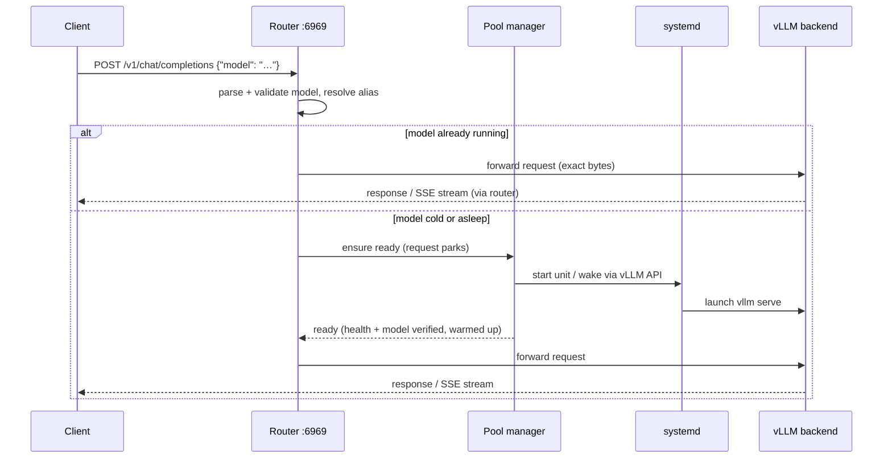

# vLLM Pooling Router

A model-routing gateway that lets a small pool of GPUs serve a large catalog of models
through vLLM's native API surface — OpenAI-compatible chat/completions/embeddings,
Anthropic's Messages API, and Cohere/Jina-style scoring and rerank. Clients send an
ordinary request (say `POST /v1/chat/completions` or `POST /v1/messages`) naming any
configured model; the router forwards to the vLLM server that serves it — and if that model isn't
running, the router **starts (or wakes) it on demand, holds the request while it loads,
and answers when it's ready**. Idle models are put to sleep or stopped automatically so
the GPUs are always available for what's actually being used.

## Why it exists

GPUs are scarce and models are many. Running one vLLM server per model wastes VRAM on
models nobody is querying; manually starting and stopping servers turns every model
switch into an ops task. This router makes the pool self-service:

- **One endpoint, many models.** Clients only know the router's address and a model name.
- **Scale-from-zero.** First request for a cold model triggers the start; the caller just
  experiences a slower first response instead of an error.
- **GPU arbitration.** One awake owner per GPU, priority-then-LRU eviction when demand
  needs a busy GPU, declared VRAM/RAM budgets validated up front.
- **Sleep mode aware.** Where validated, vLLM's sleep levels replace full restarts:
  sub-second (L1) or few-second (L2) wakes instead of multi-minute cold starts.
- **Streams are sacred.** SSE token streams pass through chunk-by-chunk, are never
  buffered or compressed, and long generations are bounded by an *inter-token* idle
  timeout rather than a total duration limit.

The router never becomes a single point of failure for running models: vLLM processes
are owned by systemd, not the router. Restarting or upgrading the router leaves every
model serving.

## How a request flows



## Requirements

- Linux with systemd (the router controls model units over D-Bus).
- vLLM ≥ 0.26 installed on the host with its models on local disk.
- NVIDIA driver/NVML visible to the router for GPU observation.
- Rust ≥ 1.85 and [`just`](https://github.com/casey/just) to build.

## Install

```console
just build                      # optimized binary in target/release/
just install --root /usr/local  # or: cargo install --path . --root /usr/local
```

Then lay down the runtime files:

| Path | Purpose |
|---|---|
| `/etc/vllm-router/pingora.yaml` | server runtime settings (threads, upgrade socket) — start from `deploy/pingora.yaml` |
| `/etc/vllm-router/router.yaml` | GPUs, policies, and service definitions — start from `src/config/example.yaml` |
| `/run/secrets/vllm-router-token` | management bearer token, root-owned, mode `0600` |
| `/etc/systemd/system/vllm@.service` | model unit template — from `deploy/vllm@.service` |
| `/etc/systemd/system/vllm-router.service` | the router itself — from `deploy/vllm-router.service` |
| `/etc/vllm/<name>.env` | per-model environment file consumed by `vllm@<name>.service` |

Each model's `.env` file supplies what the unit template runs
(`vllm serve ${MODEL_PATH} $VLLM_ARGS`):

```bash
# /etc/vllm/example-30b.env  (mode 0600)
MODEL_PATH=/srv/models/example-30b
VLLM_ARGS=--port 8100 --served-model-name example/model-30b --gpu-memory-utilization 0.9
```

Validate everything, then start:

```console
vllm-router -t -c /etc/vllm-router/pingora.yaml --router-config /etc/vllm-router/router.yaml
systemctl daemon-reload
systemctl enable --now vllm-router
```

The `-t` run parses and cross-validates the full configuration (duplicate ports, unknown
GPU UUIDs, impossible parallelism, VRAM/RAM overcommit, unsafe runner arguments) and
exits non-zero with an actionable error if anything is wrong.

## Configuration in one glance

`router.yaml` has three top-level sections — see `src/config/example.yaml` for a
complete, commented service:

- **`listeners`** — three separate binds: `data_plane` (public inference), `management`
  (authenticated control API), `metrics` (Prometheus), plus the bearer-token file path.
  All three are **required** — the router has no built-in default ports; `:6969`,
  `:6970`, and `:6971` used throughout this document are the example config's
  conventional values. (Deliberately not 8000: that is vLLM's own default port, so a
  manually-launched `vllm serve` would collide with the router's data plane.) There is
  no port flag or env var: ports are validated configuration (collision and loopback
  rules run at `-t` time), changed like any other setting via restart-to-apply. The
  router logs its effective listeners at startup (an info-level `"listeners
  configured"` line carrying all three addresses).

  **Why three listeners instead of one port with routes:** the boundary between them
  is enforced by *bind address*, not application code. The data plane must be
  client-reachable (`0.0.0.0`); management can kill workloads and belongs on
  loopback, unreachable from the network before any code runs; metrics sits apart
  from both because its consumer is a Prometheus scraper whose location can change —
  if monitoring runs on another host, only the metrics bind widens, and neither the
  mutation surface nor its bearer-token auth is dragged along. Separate ports also
  keep router-owned paths structurally disjoint from the proxied vLLM surface (which
  has its own `/metrics`), and give the management API its own service threads so it
  stays responsive while the data plane is saturated — exactly when you need it.
- **`inventory`** — host RAM and each GPU by **stable UUID** (`nvidia-smi -L`) with its
  VRAM capacity. Placement and budget validation are computed against these.
- **`services`** — one entry per model server: served model name + aliases, GPU
  assignment and parallelism, absolute `runner_executable` path, backend loopback port,
  systemd unit, readiness probes, deadlines, idle tiers (`sleep_l1_after_ms` →
  `sleep_l2_after_ms` → `stop_after_ms`), parking policy, priority/evictability, and
  sleep settings. Sleep stays off unless the service is explicitly marked
  `hardware_validated: true`. If omitted, `runner_executable` defaults to
  `/opt/vllm-venv/bin/vllm` for compatibility with existing deployments.

## API surface

### Inference (data plane, default `:6969`)

vLLM exposes several API dialects on one server, and the router forwards the
model-bearing `POST` endpoints of each, all routed by the JSON `model` field (aliases
resolve to the canonical name):

| Protocol family | Endpoints |
|---|---|
| Router model discovery | `GET /v1/models` |
| OpenAI-compatible | `/v1/chat/completions`, `/v1/completions`, `/v1/embeddings`, `/v1/responses` |
| Anthropic Messages | `/v1/messages`, `/v1/messages/count_tokens` |
| Cohere/Jina-style pooling | `/v1/score`, `/v1/rerank`, `/v2/rerank`, `/v2/embed` (plus legacy `/score`, `/rerank`) |
| vLLM native | `/tokenize`, `/detokenize`, `/classify` |

`GET /v1/models` is synthesized by the router with exactly one entry per unique
canonical `served_model`; replicas collapse into that entry rather than duplicating
it. In addition to the standard model fields, each entry includes `aliases`, the
declaration-ordered union of accepted alternate request ids across its replicas, and
`max_model_len`, copied from `compatibility.maximum_model_length`. Aliases remain
valid in inference request bodies but never appear as independent model ids.
`POST /v1/models` returns `405 Method Not Allowed`.

Everything else — including vLLM's admin endpoints (`/sleep`, `/wake_up`, …) — is
refused on this listener. Multipart endpoints such as audio transcription/translation
are not currently routed (the router parses JSON bodies for the `model` field).
Router-generated errors use the Anthropic error envelope on Messages endpoints:

```json
{"type": "error", "error": {"message": "model `x` is not configured", "type": "not_found_error"}}
```

OpenAI-compatible, Cohere/Jina-style, and vLLM-native endpoints retain the OpenAI-shaped
envelope. Errors originating from vLLM itself pass through unchanged in their native
shape.

Notable statuses: `400` malformed JSON / missing model, `404` unknown model, `413` body
over the configured limit, `503` + `Retry-After` when parking capacity or the parking
deadline is exhausted. A cold model does **not** error by default — the request parks
until the model is ready or the service's `parking.deadline_ms` expires.

### Control (management listener, default `127.0.0.1:6970`)

All `/pool/v1` calls require `Authorization: Bearer <token>`; every mutation is
audit-logged and returns `202` with an `operation_id`.

| Method & path | Purpose |
|---|---|
| `GET /pool/v1/services` | desired config + observed state for every service (lifecycle, systemd, probes, GPU, active/parked counts, last error) |
| `POST /pool/v1/services/{name}/start` | ensure running; body: `{"deadline_ms": …, "evict": true}` to allow displacing lower-priority idle models |
| `POST /pool/v1/services/{name}/wake` | same as start, for a sleeping service |
| `POST /pool/v1/services/{name}/drain` | remove from selection and wait for in-flight work to finish |
| `POST /pool/v1/services/{name}/sleep` | drain then sleep; body: `{"level": "l1"\|"l2"}` |
| `POST /pool/v1/services/{name}/stop` | drain then stop the unit; `{"force": true}` stops after the drain deadline even with work in flight |
| `GET /pool/v1/operations/{id}` | progress / terminal result of an accepted mutation |
| `POST /pool/v1/reconcile` | re-observe systemd + probes + NVML and converge state |
| `GET /livez`, `GET /readyz` | router process liveness / routing readiness (no auth) |

```console
curl -s -H "Authorization: Bearer $(cat /run/secrets/vllm-router-token)" \
  http://127.0.0.1:6970/pool/v1/services | jq '.services[] | {service, lifecycle}'

curl -s -X POST -H "Authorization: Bearer $TOKEN" \
  http://127.0.0.1:6970/pool/v1/services/example-30b/sleep -d '{"level":"l1"}'
```

### Metrics (default `127.0.0.1:6971`)

Prometheus text format:

| Metric | Meaning |
|---|---|
| `vllm_router_requests_total{model,status}` | completed requests by canonical model and outcome |
| `vllm_router_request_duration_seconds{model}` | end-to-end request latency |
| `vllm_router_parked_requests{model}` / `…_total_current` | requests currently waiting on a cold model |
| `vllm_router_parking_duration_seconds{model}` | how long parked requests waited |
| `vllm_router_transitions_total{service,transition,result}` | lifecycle transition attempts |
| `vllm_router_probe_failures_total{service,probe}` | failed systemd/HTTP/NVML observations |
| `vllm_router_active_requests{service}` | exact in-flight requests per service |
| `vllm_router_service_state{service,state}` | one-hot lifecycle state per service |

## CLI and environment reference

```
vllm-router -c <pingora.yaml> [--router-config <router.yaml>] [-t] [-u]
```

| Flag / variable | Meaning |
|---|---|
| `-c`, `--conf <path>` | Pingora server configuration (required) |
| `--router-config <path>` | router configuration; overrides `VLLM_ROUTER_CONFIG` |
| `VLLM_ROUTER_CONFIG` | env var selecting the router config path (default `/etc/vllm-router/router.yaml`) |
| `-t`, `--test` | validate both configurations and exit non-zero on any error |
| `-u`, `--upgrade` | take over listening sockets from a running instance (zero-downtime upgrade) |
| `-d`, `--daemon` | **rejected by design** — run under systemd instead (daemonizing would break the D-Bus connection) |

## Operating notes

- **Logs** are structured lines on stderr → `journalctl -u vllm-router`. Audit events for
  control-API mutations are tagged `audit=true`. Request bodies and tokens are never
  logged.
- **Generated model units are boot-ephemeral.** The router writes them under
  `/run/systemd/system` and asks systemd to reload its unit files during router startup.
  Because `/run` is cleared on host reboot, enable `vllm-router.service` as the boot entry
  point and let it start once before starting any model service. Do not independently
  enable generated model units for boot; they do not exist until router initialization
  regenerates them and completes the systemd reload.
- **Router restart/upgrade never stops healthy models.** For zero-downtime binary
  upgrades, start the new binary with `-u` (after it passes `-t`) and send `SIGQUIT` to
  the old one; listeners hand over via the upgrade socket and in-flight streams drain
  within the configured grace period.
- **Manual changes reconcile.** If you `systemctl stop` a model behind the router's back,
  the periodic reconciler observes and converges; `POST /pool/v1/reconcile` forces it.
- **Configuration changes are restart-to-apply.** The router uses one immutable snapshot
  for its process lifetime. Always validate the replacement files with
  `vllm-router -t -c /etc/vllm-router/pingora.yaml --router-config /etc/vllm-router/router.yaml`
  before either a supervised restart or a `-u` graceful upgrade. If validation fails, leave
  the current process serving its last valid snapshot. Running systemd-owned model processes
  remain up and are reconstructed by reconciliation.

## Development

```console
just test      # full test suite (fast; hardware-dependent tests are #[ignore]d)
just lint      # rustfmt --check + clippy -D warnings
just build     # release build
just install   # cargo install
```

Design documents live in `features/2026-07-28-pooling/` (spec, plan, phase-0 findings,
implementation reviews). Architecture and implementation detail for contributors is in
[`docs/technical-overview.md`](docs/technical-overview.md).

## Status

Single-host v1. Known limitations: sleep mode requires per-service hardware validation
(see the sm_120 matrix in `features/2026-07-28-pooling/phase0-findings.md`); one awake
owner per GPU (no co-residency); completion responses are never cached. Current defect
list and remediation order: `features/2026-07-28-pooling/review-1.md`.
