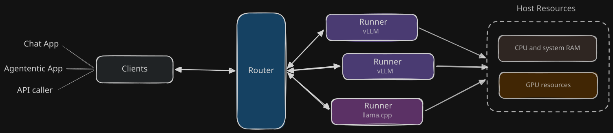

# LLM Router

## Overview

The **LLM Router** provides a single API surface for a client to point at to reach a variety of locally served LLM models. In the diagram above you
see the major _entities_ involved in this ecosystem:

### Clients

- clients can connect to a single API surface to gain access to all locally hosted models on a given host
    - this will become all local models _across_ hosts in v3 of the project
- any chat or agentic program should be able to interface with the **LLM Router** _out of the box_ due to it's ability to expose a unified OpenAI, Anthropic, Cohere based API surface for model discovery and inference

### The Router

- the router must understand the host's _available resources_ and manage how the Runner apps and their LLM models utilize these resources
- how the router manages these resources will be determined initially by configuration but afterward by an admin who will modify settings via either the [administrative dashboard](./admin-dashboard.md) or via the [adminstrative API](./admin-api.md). Management will fit into two discrete "modes":
    - Static
    - Dynamic

### The Runners

- the router knows how to manage both [vLLM](./vllm.md) and [llama.cpp](./llama.cpp.md) runners
- directly running vLLM or llama.cpp on the host is considered bad practice, instead it is expected that the use of these runners will be managed by the router
- when the router is fully responsible for operating the runners and their models it can do a better job of avoiding resource contention
    - the most obvious and clear resource contention which must be managed is the GPU pool
    - to a lessor degree the CPU and system memory also need to be at a minimum _monitored_ but also possibly _guarded_ too

## Phase 2 & 3

- in Phase 2 we will start to extend the functionality that the **LLM Router** 

## More Detailed Reading
