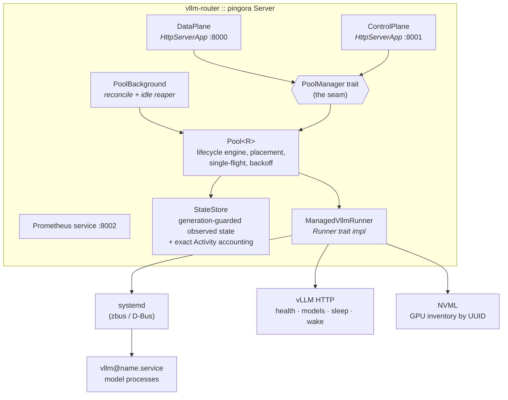
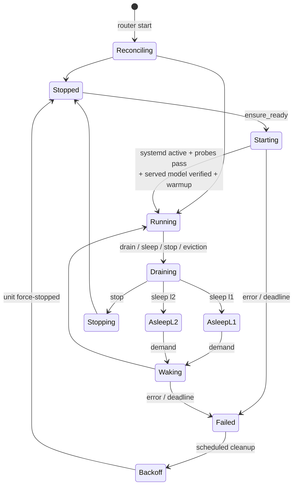

# Technical Overview

Companion to the [README](../README.md), for engineers working on or evaluating the
router's internals. Authoritative requirements live in
[`features/2026-07-28-pooling/spec.md`](../features/2026-07-28-pooling/spec.md); this
document describes how the implementation realizes them. Known defects and their
remediation order are tracked in
[`review-1.md`](../features/2026-07-28-pooling/review-1.md).

## Architecture

One Rust binary built on Pingora 0.8.1 (pinned exactly; pre-1.0 API churn is real).
Pingora provides the process/runtime layer — listeners, worker threads, daemonization,
graceful shutdown and the zero-downtime upgrade socket — while the router contributes
three Pingora services and a background loop:

**The seam.** `proxy/`, `api/`, and `metrics/` may touch the pool only through the
`PoolManager` trait (`ensure_ready`, `drain`, `sleep`, `stop`, `status`, `reconcile`,
`subscribe`, plus the exact-accounting hooks `acquire_active`/`acquire_parked`). The
pool owns everything below it: the `Runner` trait and its production implementation,
the systemd/NVML/probe adapters, and the state store. This is the multi-host cut line:
a future per-host agent replaces `Pool<R>` behind the same trait with an HTTP client,
and neither the data plane nor the control API changes.

**Process ownership.** The router never spawns model processes. vLLM units belong to
systemd (`StartUnit`/`StopUnit` over D-Bus via zbus); the router's crash or upgrade
leaves them serving, and reconciliation re-derives all live state from observation —
nothing about running services is persisted.

## Data plane

The data plane is a custom Pingora `HttpServerApp`, **not** a `ProxyHttp`
implementation. The Phase-0 spike
([`phase0-findings.md`](../features/2026-07-28-pooling/phase0-findings.md)) showed that
pinned Pingora 0.8.1 cannot generally read-then-replay a request body before
`upstream_peer`: the only replay facility is the retry buffer, hard-capped at 64 KiB —
too small for multimodal OpenAI payloads. The spec's sanctioned fallback is this custom
ingress: buffer only the (bounded) request body, forward the exact bytes with reqwest,
and copy response chunks downstream as they arrive.

Request handling, in order (`proxy/ingress.rs`):

1. **Endpoint allowlist.** Only known model-bearing `POST` endpoints proceed — the
   OpenAI-compatible family, Anthropic's `/v1/messages`, and the Cohere/Jina-style
   score/rerank/classify endpoints (`MODEL_ENDPOINTS` in `proxy/ingress.rs`). vLLM
   admin/dev endpoints and `/pool` are refused on this listener regardless of upstream
   support. Multipart endpoints (audio transcription) are not routable today because
   model extraction assumes a JSON body.
2. **Bounded body read.** `Content-Length` is checked first, then the body is read with
   a running cap; overflow drains the connection and returns 413 before any parsing.
3. **Model routing.** `serde_json` extracts only the `model` field (bytes are never
   modified); aliases resolve to a canonical served-model name; unknown → OpenAI-shaped
   404. Invalid requests fail here — before any lifecycle machinery can be triggered.
4. **Admission.** Fast path: among `Running` replicas of the model, pick least-inflight
   and atomically acquire an exact active-request guard (a drain racing this loses —
   admission is serialized against lifecycle transitions per service).
5. **Parking (cold path).** If nothing is running: acquire global and per-model parking
   permits (semaphores — exhaustion returns 503 + `Retry-After`), then a parked-slot
   guard, then call `ensure_ready` with the service's parking deadline. The call is
   raced against downstream-disconnect detection (`read_body_or_idle` on the
   already-consumed request), so a hung-up client frees its slot immediately — but the
   underlying start continues, because other waiters may need it (single-flight,
   detached).
6. **Forwarding.** Hop-by-hop and `Connection`-nominated headers are stripped both
   directions, `Host` is set to the backend, `x-request-id`/`traceparent` are added.
   Response chunks stream through one at a time; nothing aggregates SSE, and
   compression is never enabled. The reqwest client's read timeout is the **inter-chunk**
   idle deadline (reqwest resets it on every received byte), so long active generations
   survive while a stalled stream fails.
7. **Failover.** Only a *connect* failure (no bytes sent) may retry on a different
   replica, once. After the request may have reached an upstream — and certainly after
   response headers or SSE data reach the client — no retry occurs.

## Lifecycle engine

Each service definition compiles into a `ServiceDefinition` for the generic pool, which
tracks observed state per service:

Key mechanics (`pool/mod.rs`, `state/mod.rs`):

- **Single-flight transitions.** Each service has one `Flight` slot. Concurrent
  `ensure_ready` calls for the same target join the existing flight and share its
  outcome (the 50-way stampede test asserts exactly one start); an incompatible
  concurrent transition is rejected with `transition_in_progress`. Flights run as
  detached tasks — a caller hitting its own deadline abandons the wait without
  cancelling the shared work.
- **Generation guards.** Every transition bumps a per-service generation and records an
  operation ID; all state writes go through `update_if_current`, so a stale probe, a
  late flight completion, or an orphaned backoff task cannot clobber newer state.
- **Readiness is layered.** `Running` requires systemd `active` + consecutive-success
  HTTP probe thresholds + the served-model name confirmed via `/v1/models` + GPU
  observation — then a configurable warmup request runs (vLLM pays compile cost on the
  first inference; warming at start/wake keeps it off client latency).
- **Placement.** Declaration-based: services declare GPU UUIDs and VRAM reservations;
  at most one awake owner per GPU (v1 rule). Contended cold starts queue FIFO. If the
  blocking owner is evictable, idle (exact counters — see below), and not mid-transition,
  the scheduler evicts by lowest priority, then least-recently-used; otherwise the
  demand waits for a natural drain until its deadline.
- **Idle tiers.** The reaper walks `sleep_l1_after` → `sleep_l2_after` → `stop_after`
  per service, and every automatic transition drains first — a service with any active
  or parked request is never slept, stopped, or evicted by policy.
- **Failure handling.** A failed start/wake marks the service `Failed`, fans the same
  terminal error out to every parked waiter (no retry stampede), then a background task
  applies jittered exponential backoff and force-stops the unit to release GPU memory.

## Sleep and wake

Sleep support is per-service opt-in and additionally gated on
`hardware_validated: true` — config validation rejects enabled-but-unvalidated sleep,
because sm_120/Blackwell has open upstream bugs (see the Phase-0 matrix). The runner
speaks vLLM 0.26's dev-mode surface: `POST /sleep?level=N`, `GET /is_sleeping`, and for
L2 wake the required three-step sequence — `wake_up?tags=weights` →
`collective_rpc {"method":"reload_weights"}` → `wake_up?tags=kv_cache` — asserted by a
sequence test. A sleeping vLLM answers inference with 503 and queues nothing, which is
why the router's parking + wake-then-forward design exists. Budget validation accounts
for sleep: L1 pins roughly weight-size host RAM, and slept services retain residual
VRAM, both declared per service and checked across every allowed awake/asleep
combination at config load.

## Observation and reconciliation

`Runner::observe` composes three sources into one `RunnerObservation`:

| Source | Adapter | Yields |
|---|---|---|
| systemd | `sysd/` (zbus, system bus) | unit active/sub state |
| vLLM HTTP | `runner/vllm.rs` (bounded reqwest) | health, served models, `is_sleeping` |
| NVML | `gpu/` (`spawn_blocking`) | per-UUID memory use, compute PIDs |

Probe results pass through consecutive-success/failure debouncing before flipping
readiness, so a single blip neither admits nor evicts traffic. A periodic background
service reconciles all services and runs the idle reaper; router startup begins in
`Reconciling` and reconstructs the entire pool picture from these observations — the
router trusts what it sees, not what it last did, so out-of-band `systemctl` actions
converge instead of desynchronizing.

## Exact accounting

Lifecycle safety decisions (drain complete? safe to sleep? eviction victim idle?) use
**exact** counters: RAII `ActiveGuard`/`ParkedGuard` values from the state store,
acquired atomically with admission and released on every exit path including client
disconnect. Approximate structures (the pingora-limits sketches) are deliberately not
used for these decisions — an over- or under-estimate could strand a request on a
dying backend or wedge a drain. Parking capacity uses semaphores (global and
per-model) so cold-start stampedes are bounded before they reach the pool.

## Configuration model

`config/` deserializes strict YAML (unknown fields rejected) and then cross-validates:
identity (duplicate names/aliases/ports, alias-vs-canonical ambiguity), placement
(unknown GPU UUIDs, parallelism vs GPU count, per-GPU awake-owner policy), safety
(loopback-only backends, a per-service absolute runner executable path, absolute model
paths, allowlisted vLLM runner arguments with control-character and Ray-executor rejection,
newline-safe systemd command/environment values), timing
(threshold/interval/deadline sanity, parking vs startup deadlines), and **budgets** —
host pinned-RAM under the all-L1-asleep worst case, and per-GPU VRAM for both
all-asleep and each-awake-plus-others-asleep combinations, which under the
one-awake-owner rule are exactly the reachable states. `ConfigStore` holds one validated
snapshot that is immutable for the router process lifetime. There is no SIGHUP or control
endpoint for live reload: edit the YAML, validate it with `vllm-router -t`, and apply it
with a supervised router restart. An invalid configuration prevents the replacement
process from starting; systemd-owned model processes remain up and are reconstructed by
startup reconciliation.

## Security model

- **Three listeners, three policies.** Public data plane (endpoint-allowlisted, no admin
  surface), management (bearer token required before any routing or body read; token
  file must be root-owned mode `0600`; comparison is constant-time), metrics (scrape
  only).
- vLLM backends bind loopback and are enforced loopback by config validation; the
  router is the only client-facing entry. vLLM's unauthenticated dev-mode endpoints are
  reachable only from the host.
- Every accepted mutation emits a structured `audit=true` log line (operation ID,
  service, action, flags) to journald. No request bodies, no credentials, ever.

## Testing strategy

- **Fast suite** (`just test`, no hardware): table-driven config validation, routing
  parser, generation-guarded state store, and pool-engine behavior against an
  in-process mock `Runner` — single-flight stampede, FIFO contention, eviction safety,
  drain deadlines, idle tiers, failure fanout, and the L2 wake sequence.
- **On-box suite** (`#[ignore]`d): live systemd D-Bus round-trips, real vLLM
  streaming/body-fidelity drills, and the sm_120 sleep validation matrix
  (TP × quantization × level, five cycles each with output-sanity checks). These gates
  are recorded — deliberately unclaimed until run on the target host — in
  [`phase0-findings.md`](../features/2026-07-28-pooling/phase0-findings.md) and
  [`acceptance.md`](../features/2026-07-28-pooling/acceptance.md).

## Design decisions worth knowing

| Decision | Rationale |
|---|---|
| Custom ingress instead of `ProxyHttp` | 64 KiB replay ceiling in pinned Pingora (Phase-0 S1); revisit if upstream grows a bounded body-replay API |
| systemd owns processes | crash-restart, cgroup/GPU-zombie cleanup, and router/model lifetime decoupling for free |
| Declaration-based GPU budgeting | vLLM pre-allocates `gpu_memory_utilization` at startup, so free-VRAM measurement can't drive placement; NVML is for observation and drift, not scheduling |
| Park, don't 503, on cold models | callers get latency instead of retry loops; caps + deadlines bound the cost |
| Exact guards over sketches | lifecycle safety needs zero/nonzero truth, not estimates |
| One awake owner per GPU (v1) | eliminates co-residency profiling; slept residuals still share, validated by budget checks |
