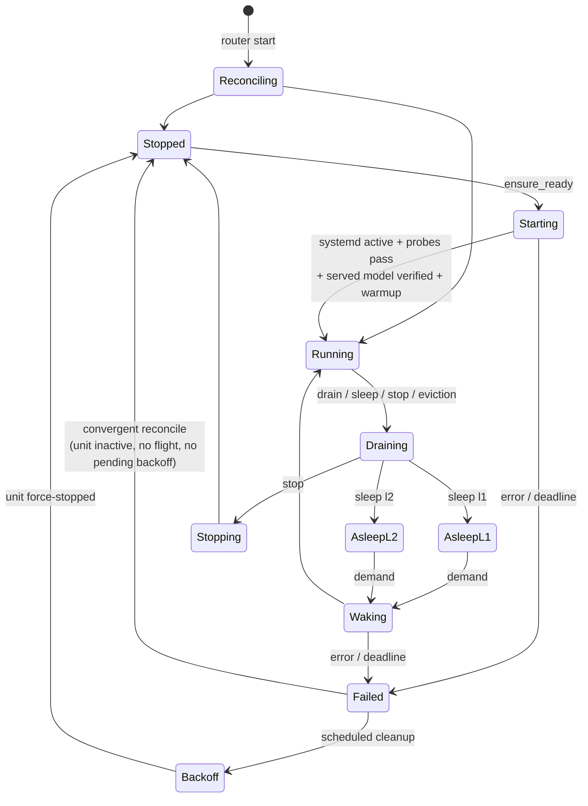

# LLM Router — Technical Overview

This document explains **why the LLM Router is built the way it is**, for engineers
working on it or evaluating it. It is not a reference manual: operational instructions
live in the [README](../README.md), and the authoritative requirements live in
[`features/2026-07-28-pooling/spec.md`](../features/2026-07-28-pooling/spec.md).

vLLM is the only model runner implemented today, so much of the detail here describes it
specifically. Where a section says "vLLM," it is naming the runner, not the project.

It is organized so the reasoning arrives before the detail:

1. **[The job](#the-job)** — what the router does, who the actors are, and the three
   tensions that make it non-trivial.
2. **[Constraints we did not choose](#constraints-we-did-not-choose)** — fixed properties
   of vLLM, Pingora, systemd, and GPUs. Most of the surprising design follows from these
   rather than from preference.
3. **[Decisions we did make](#decisions-we-did-make)** — the choices layered on top, each
   traceable to a constraint, each with its cost stated.
4. **[Architecture](#architecture)** — how the pieces fit, once you know why they exist.
5. Subsystem detail, from the [data plane](#data-plane) onward.

If you are about to make a deep change, also read
`features/2026-07-28-pooling/review-{1,2,3}.md`. All findings are closed and
independently validated, but the reviews double as a catalog of sharp edges already hit
— runtime nesting, systemd quoting, GPU pinning, parser selection.

## The job

One host, several large language models, not enough GPU memory to keep them all loaded.
The router accepts OpenAI-compatible inference requests, decides which model process
should serve each one, and starts, wakes, or stops those processes so the GPUs are
occupied by whatever is actually in demand — without the client needing to know any of
it happened.

Four actors, with a strict division of ownership:

| Actor | Owns | The router's relationship to it |
|---|---|---|
| **Client** | the request | sees one stable OpenAI-compatible endpoint, never learns which backend served it |
| **Router** | routing, admission, lifecycle policy | the only client-facing process; decides *when* a model should be resident |
| **systemd** | the model processes | starts and stops units on the router's instruction; owns restart and cleanup |
| **Model runner** | model execution and GPU memory | one process per model, loopback-bound; the router never spawns one directly. vLLM is the only implemented runner; llama.cpp is the next planned adapter |

Three tensions make this harder than proxying:

- **Idle costs the same as busy.** A loaded model process reserves its VRAM at startup and
  holds it whether or not requests arrive. Residency is therefore a scheduling problem,
  not a caching one — something must decide what gets evicted, and when.
- **Starting is slow, but clients need fast answers.** A cold start on a large quantized
  model is minutes. A client hanging silently for minutes is worse than an error, so the
  router must fail informatively while still doing the slow work.
- **The router's picture of reality is always slightly stale.** systemd state, HTTP
  probes, and NVML are sampled asynchronously, yet safety decisions — is this backend
  ready? is it safe to sleep? is this eviction victim truly idle? — must be made from
  facts that could be out of date the moment they are read.

Nearly every mechanism below exists to resolve one of those three.

## Constraints we did not choose

These are properties of the environment. They are stated first because several designs
that look arbitrary are the only remaining option once you account for them.

### GPU memory

- A loaded model holds its full reservation regardless of traffic. There is no partial
  release short of the sleep or stop mechanisms described later.
- Two models sharing one GPU requires profiling their combined footprint, which is a
  per-pair, per-host measurement exercise.

### vLLM

- **It pre-allocates.** `gpu_memory_utilization` is claimed at startup, so measuring free
  VRAM tells you nothing about what will fit next. Placement cannot be driven by
  observation.
- **The first inference is slow.** Compile and CUDA-graph capture happen on first use, so
  a model that is "ready" by every health check still owes the first client a large
  latency bill.
- **Sleep exists, with sharp edges.** It requires `--enable-sleep-mode` at launch and its
  endpoints live behind dev mode. A *sleeping* backend accepts a request and then produces
  nothing rather than refusing it. Waking from the deeper level requires a specific
  three-call sequence. Measured host-RAM cost exceeds what the weight size predicts.
- **Some topologies simply fail.** Tensor-parallel degree 2 with NVFP4 dies inside
  FlashInfer's FP4 quantizer (`last dim has to be multiple of 16, but got 2152`).
  Capability is per checkpoint, per runtime version, per host.

### Pingora 0.8.1 (pinned exactly; pre-1.0 API churn is real)

- **No general body replay.** A `ProxyHttp` implementation cannot read-then-replay a
  request body before `upstream_peer`; the only replay facility is a retry buffer capped
  at 64 KiB, far too small for multimodal OpenAI payloads. Established by spike, recorded
  in [`phase0-findings.md`](../features/2026-07-28-pooling/phase0-findings.md).
- **`run_forever()` calls `block_on`** and panics inside any tokio context, which
  constrains how the process may be started.
- **Graceful shutdown sleeps the entire grace window** whether or not anything is in
  flight; it does not exit early once requests drain.

### systemd

- It already solves process supervision, cgroup teardown, and GPU-zombie cleanup — work
  that would otherwise have to be reimplemented and got right.
- Units written under `/run/systemd/system` do not survive a host reboot.
- Its control surface is D-Bus, reached here through zbus.

### Operational reality

- People run `systemctl stop` behind the router's back, and the router may itself crash or
  be upgraded. Neither event should disturb a healthy model serving traffic.

## Decisions we did make

Each of these is a choice, not a necessity — but each answers a constraint above, and
each costs something. The cost column is the part worth arguing with.

| Decision | Answers | Cost accepted |
|---|---|---|
| **Custom Pingora `HttpServerApp`, not `ProxyHttp`** | the 64 KiB replay ceiling | more ingress code to own; revisit if upstream grows a bounded body-replay API |
| **systemd owns every model process; the router never spawns one** | supervision, cleanup, surviving router restarts | no persisted state — the router must re-derive everything by observation |
| **Declaration-based GPU budgeting** | vLLM pre-allocates, so measurement can't schedule | operators must declare reservations accurately; validation enforces the arithmetic. NVML is for observation and drift detection, never scheduling |
| **At most one awake owner per GPU (v1)** | co-residency needs per-pair profiling | lower utilization than a profiled system; slept residuals still share, and budget validation accounts for them |
| **Models start only on demand** | idle residency costs full VRAM | the first request after an idle period pays a start |
| **Short parking window, then an informative 503** | cold start is minutes; silence is worse than an error | the client must retry; the window is sized to *wake* time, not cold-start time |
| **The start continues after the request gives up** | other waiters need the same model | a request that failed can still leave a model resident — surprising unless you know it |
| **Admission fails closed on stale facts** | observation is asynchronous, and a sleeping backend hangs instead of refusing | availability is traded for correctness; a lagging observer degrades into 503s, which is why probe-age budgets are validated |
| **Exact counters, never approximations** | lifecycle safety is a zero-or-nonzero question | per-request guard bookkeeping instead of cheap sketches |
| **One immutable config snapshot per process lifetime** | eliminates a whole class of mid-flight reconfiguration races | changes are restart-to-apply; there is no SIGHUP |
| **Sleep is off until measured on the target host** | measured L1 host RAM exceeds weight-size estimates | sleep is unavailable until someone does the work; stop/start is the fallback |
| **All pool access behind the `PoolManager` trait** | keeps a future multi-host split viable | one layer of indirection today |
| **Separate inference and management credentials** | lifecycle mutations spend GPU time and money | two secrets to provision instead of one |

## Architecture

One Rust binary. Pingora supplies the process and runtime layer — listeners, worker
threads, graceful shutdown, the zero-downtime upgrade socket — and the router contributes
three services plus a background loop.

Two runtime rules are load-bearing, both consequences of the `run_forever()` constraint:
`main` is **synchronous** (daemon mode is additionally rejected for the related fork
hazard), and the zbus/pool construction happens on a **dedicated process-lifetime
runtime** so its I/O tasks never lose their executor.

**The seam.** `proxy/`, `api/`, and `metrics/` may touch the pool only through the
`PoolManager` trait (`ensure_ready`, `drain`, `sleep`, `stop`, `status`, `reconcile`,
`subscribe`, plus the exact-accounting hooks `acquire_active`/`acquire_parked`). The pool
owns everything below it: the `Runner` trait and its production implementation, the
systemd/NVML/probe adapters, and the state store. This is the multi-host cut line — a
future per-host agent replaces `Pool<R>` behind the same trait with an HTTP client, and
neither the data plane nor the control API changes.

**Process ownership.** The router never spawns model processes. Model units belong to
systemd (`StartUnit`/`StopUnit` over D-Bus via zbus); the router's crash or upgrade leaves
them serving, and reconciliation re-derives all live state from observation — nothing
about running services is persisted. That is what makes the router restartable under
traffic, and it is why the observation layer is as careful as it is.

---

The remainder is subsystem detail. Each section assumes the constraints and decisions
above.

## Data plane

The request path: authenticate, validate, decide whether a backend can serve this *right
now*, and if not, decide whether to wait or to fail with useful information.

It is a custom Pingora `HttpServerApp` rather than a `ProxyHttp` implementation, for the
replay reason above. The sanctioned fallback is: buffer only the (bounded) request body,
forward the exact bytes with reqwest, and copy response chunks downstream as they arrive.

Request handling, in order (`proxy/ingress.rs`):

1. **Authentication.** The first statement in `process`: a constant-time bearer-token
   check against `listeners.inference_bearer_token_file`, a root-owned mode-`0600` file
   distinct from the management token. It runs before the endpoint allowlist, before the
   body is read, and before any admission or lifecycle call, so an unauthenticated caller
   can neither enumerate models via `GET /v1/models` nor cause a park, eviction, or cold
   start. Rejections are `401` in the endpoint's own error dialect. The credential is not
   forwarded upstream — backends are loopback-bound and hold no matching key. `/livez` and
   `/readyz` are unaffected: they live on the management listener, not here.
2. **Endpoint allowlist.** Only known model-bearing `POST` endpoints proceed — the
   OpenAI-compatible family, Anthropic's `/v1/messages`, and the Cohere/Jina-style
   score/rerank/classify endpoints (`MODEL_ENDPOINTS` in `proxy/ingress.rs`). vLLM
   admin/dev endpoints and `/pool` are refused on this listener regardless of upstream
   support. Multipart endpoints (audio transcription) are not routable today because model
   extraction assumes a JSON body.
3. **Bounded body read.** `Content-Length` is checked first, then the body is read with a
   running cap; overflow drains the connection and returns 413 before any parsing.
4. **Model routing.** `serde_json` extracts only the `model` field (bytes are never
   modified); aliases resolve to a canonical served-model name; unknown → OpenAI-shaped
   404. Invalid requests fail here — before any lifecycle machinery can be triggered.
5. **Admission.** Fast path: among `Running` replicas of the model, pick least-inflight and
   atomically acquire an exact active-request guard. Under the same per-service admission
   lock, require a fresh cached observation showing systemd active, healthy and ready with
   the expected served model, and no sleep level. Stale, incomplete, or sleeping
   observations fail closed; a drain or reconcile racing admission wins.
6. **Parking (cold path).** If nothing is running: acquire global and per-model parking
   permits (semaphores — exhaustion returns 503 + `Retry-After`), then a parked-slot guard,
   then call `ensure_ready` with the service's parking deadline. The deadline is
   deliberately *short* (~20 s default — the short-park amendment to spec Decision 3):
   sized to wake time, not cold-start time. On expiry the client gets a progress-reporting
   `model_starting` 503 (elapsed + typical duration + `Retry-After`) while the detached
   start keeps warming. The call is raced against downstream-disconnect detection
   (`read_body_or_idle` on the already-consumed request), so a hung-up client frees its
   slot immediately — but the underlying start continues, because other waiters may need it
   (single-flight, detached).
7. **Forwarding.** Hop-by-hop and `Connection`-nominated headers are stripped both
   directions, `Host` is set to the backend, `x-request-id`/`traceparent` are added.
   Response chunks stream through one at a time; nothing aggregates SSE, and compression is
   never enabled. The reqwest client's read timeout is the **inter-chunk** idle deadline
   (reqwest resets it on every received byte), so long active generations survive while a
   stalled stream fails. Reqwest timeout sources are classified before logging, producing a
   bounded `upstream response idle timeout` diagnostic instead of its generic
   response-body decode wrapper.
8. **Failover.** Only a *connect* failure (no bytes sent) may retry on a different replica,
   once. After the request may have reached an upstream — and certainly after response
   headers or SSE data reach the client — no retry occurs.

## Lifecycle engine

Where residency policy lives: which model is resident, what transition it is undergoing,
and who is allowed to displace whom. Each service definition compiles into a
`ServiceDefinition` for the generic pool, which tracks observed state per service:

Key mechanics (`pool/mod.rs`, `state/mod.rs`):

- **Single-flight transitions.** Each service has one `Flight` slot. Concurrent
  `ensure_ready` calls for the same target join the existing flight and share its outcome
  (the 50-way stampede test asserts exactly one start); an incompatible concurrent
  transition is rejected with `transition_in_progress`. Flights run as detached tasks — a
  caller hitting its own deadline abandons the wait without cancelling the shared work.
- **Generation guards.** Every transition bumps a per-service generation and records an
  operation ID; all state writes go through `update_if_current`, so a stale probe, a late
  flight completion, or an orphaned backoff task cannot clobber newer state.
- **Readiness is layered.** `Running` requires systemd `active` + consecutive-success HTTP
  probe thresholds + the served-model name confirmed via `/v1/models` + GPU observation —
  then a configurable warmup request runs, moving vLLM's first-inference compile cost off
  client latency.
- **Placement.** Services declare GPU UUIDs and VRAM reservations; at most one awake owner
  per GPU. Contended cold starts queue FIFO. If the blocking owner is evictable, idle
  (exact counters — see below), and not mid-transition, the scheduler evicts by lowest
  priority, then least-recently-used; otherwise the demand waits for a natural drain until
  its deadline.
- **Idle tiers.** The reaper walks `sleep_l1_after` → `sleep_l2_after` → `stop_after` per
  service, and every automatic transition drains first — a service with any active or
  parked request is never slept, stopped, or evicted by policy.
- **Failure handling.** A failed start/wake marks the service `Failed`, fans the same
  terminal error out to every parked waiter (no retry stampede), then a background task
  applies jittered exponential backoff and force-stops the unit to release GPU memory.

## Sleep and wake

Sleep is a vLLM feature that releases a model's GPU memory while leaving its process
alive, so returning costs seconds rather than a full reload. It has two levels, which this
codebase calls L1 and L2: **L1** copies the weights out to host RAM and wakes with a single
`wake_up`; **L2** discards them, so waking must re-read the weights from disk.

Sleep support is per-service opt-in and additionally gated on `hardware_validated: true`,
which config validation requires before it will accept `sleep.enabled` — a service may not
sleep until someone has measured it sleeping and waking on the target host.

The runner speaks vLLM 0.26's dev-mode surface: `POST /sleep?level=N`, `GET /is_sleeping`,
and for L2 wake the required three-step sequence — `wake_up?tags=weights` →
`collective_rpc {"method":"reload_weights"}` → `wake_up?tags=kv_cache` — asserted by a
sequence test.

Nothing has cleared that gate on this hardware yet, for two reasons found by measurement
rather than by inspection:

- **A sleeping backend hangs instead of refusing.** Direct inference against a sleeping
  model was accepted and then produced no bytes before the client timed out; it did not
  return 503. The router therefore never treats a backend response as the sleep safety
  barrier: fresh fail-closed admission parks an asleep model, wakes and reprobes it before
  forwarding, and the inter-chunk idle timeout bounds a backend that stalls after
  admission.
- **Weight size underestimates L1 host RAM.** Every model measured so far exceeded a
  provisional declaration sized from its weights, so an L1 reservation must meet a measured
  floor recorded per checkpoint and runtime (25 GB for the tested FP8 model, 40 GB for
  NVFP4). Slept services also retain residual VRAM; both reservations are checked across
  every allowed awake/asleep combination at config load.

One topology additionally failed to launch at all: tensor-parallel degree 2 with NVFP4
died inside FlashInfer's FP4 quantizer (`last dim has to be multiple of 16, but got
2152`). That is recorded in `compatibility.unsupported_tensor_parallelism`, and the
boot-time validator rejects selecting a degree declared failed.

## Observation and reconciliation

This is the subsystem that answers the third tension — acting safely on facts that are
necessarily a little out of date. `Runner::observe` composes three sources into one
`RunnerObservation`:

| Source | Adapter | Yields |
|---|---|---|
| systemd | `sysd/` (zbus, system bus) | unit active/sub state |
| vLLM HTTP | `runner/vllm.rs` (bounded reqwest) | health, served models, `is_sleeping` |
| NVML | `gpu/` (`spawn_blocking`) | per-UUID memory use, compute PIDs |

Probe results pass through consecutive-success/failure debouncing before flipping
readiness, so a single blip neither admits nor evicts traffic. A periodic background
service reconciles all services and runs the idle reaper; router startup begins in
`Reconciling` and reconstructs the entire pool picture from these observations — the router
trusts what it sees, not what it last did, so out-of-band `systemctl` actions converge
instead of desynchronizing. That also bounds what a runtime latch can promise: `drained` is
held in memory and survives reconciliation, but not a router restart.

One loop reconciles every service, so the *shortest* configured `readiness.interval_ms` is
the observation cadence for all of them (`RouterConfig::observation_interval_ms`). Because
admission rejects probe facts older than `readiness.maximum_probe_age_ms`, that budget is
load-bearing rather than advisory: config validation requires it to cover two observation
periods plus one probe timeout, so a single missed or slow pass degrades latency instead of
503-ing the fleet. `vllm_router_admission_rejections_total{reason="stale_probe"}` is the
signal that the margin is being consumed.

Only a *proven* observation refreshes that timestamp. `sleeping_level: None` can mean sleep
is disabled, the backend answered "awake", or `/is_sleeping` could not be reached; the third
case retains the last authoritative level but deliberately leaves the timestamp alone. A
single failed sleep probe is therefore absorbed, while sustained failure ages the fact out
and closes admission — rather than presenting an unproven "awake" to the one check standing
between a sleeping backend and a hung request.

## Exact accounting

Lifecycle safety decisions (drain complete? safe to sleep? eviction victim idle?) use
**exact** counters: RAII `ActiveGuard`/`ParkedGuard` values from the state store, acquired
atomically with admission and released on every exit path including client disconnect.
Approximate structures (the pingora-limits sketches) are deliberately not used for these
decisions — an over- or under-estimate could strand a request on a dying backend or wedge a
drain. Parking capacity uses semaphores (global and per-model) so cold-start stampedes are
bounded before they reach the pool.

## Configuration model

Because placement is declaration-based, configuration is where most correctness is
enforced — the validator is doing the work that runtime measurement cannot.

`config/` deserializes strict YAML (unknown fields rejected) and then cross-validates:
identity (duplicate names/aliases/ports, alias-vs-canonical ambiguity), placement (unknown
GPU UUIDs, parallelism vs GPU count, per-GPU awake-owner policy), safety (loopback-only
backends, a per-service absolute runner executable path, absolute model paths, allowlisted
vLLM runner arguments with control-character and Ray-executor rejection, newline-safe
systemd command/environment values, tool/reasoning parser names checked against the
installed vLLM's registries), timing (threshold/interval/deadline sanity, parking vs
startup deadlines), and **budgets** — host pinned-RAM under the all-L1-asleep worst case,
and per-GPU VRAM for both all-asleep and each-awake-plus-others-asleep combinations, which
under the one-awake-owner rule are exactly the reachable states.

`ConfigStore` holds one validated snapshot that is immutable for the router process
lifetime. There is no SIGHUP or control endpoint for live reload: edit the YAML, validate
it with `vllm-router -t`, and apply it with a supervised router restart. An invalid
configuration prevents the replacement process from starting; systemd-owned model processes
remain up and are reconstructed by startup reconciliation.

**Unit generation** renders complete units under `/run/systemd/system` plus mode-`0600`
environment files: bare (unquoted) `EnvironmentFile=` paths, GPU UUIDs translated via NVML
to numeric `CUDA_VISIBLE_DEVICES` with `CUDA_DEVICE_ORDER=PCI_BUS_ID`, and the allowlisted
`environment:` maps merged global-then-service. Rendered units are checked with
`systemd-analyze verify` in tests — the quoting/typo class of systemd defect fails CI rather
than silently not loading at runtime.

## Security model

- **Three listeners, three policies.** Public data plane (endpoint-allowlisted, no admin
  surface, inference bearer token required before any routing or body read), management
  (management bearer token required before any routing or body read), metrics (scrape
  only). Both token files must be root-owned mode `0600`, both comparisons are
  constant-time, and the two files must be distinct — validation rejects a config that
  points them at the same secret, because an inference client must never hold a credential
  that authorizes lifecycle mutations.
- **Credentials survive host restarts.** The token files are long-lived client
  credentials and belong on persistent storage, conventionally
  `/etc/vllm-router/secrets/{inference-token,management-token}` in a root-owned mode-`0700`
  directory. Never place them under `/run` or `/var/run`: those trees are tmpfs on this
  host, so a reboot deletes the credentials, prevents the router from starting, and makes
  every previously configured client key unusable. `just token` creates either missing
  file without replacing an existing credential.
- **Neither token has a default.** Both paths are required config, so a config that omits
  one fails at `-t` time instead of silently exposing a listener that can spend GPU time.
  `GET /livez` and `GET /readyz` on the loopback management bind are the only
  unauthenticated endpoints; health checking therefore never needs a credential.
- Model backends bind loopback and are enforced loopback by config validation; the router
  is the only client-facing entry. vLLM's unauthenticated dev-mode endpoints are reachable
  only from the host.
- Every accepted mutation emits a structured `audit=true` log line (operation ID, service,
  action, flags) to journald. No request bodies, no credentials, ever.

Token rotation is deliberately explicit: create a new mode-`0600`, root-owned file on
persistent storage, update the corresponding configured path, validate with `vllm-router
-t`, distribute an inference token to clients when applicable, and then restart the
router. There is no live credential reload and no fallback token. Losing a token file is
therefore recovery by minting and distributing a new credential, not restoration of the
old value.

## Testing strategy

- **Fast suite** (`just test`, no hardware): table-driven config validation, routing parser,
  generation-guarded state store, and pool-engine behavior against an in-process mock
  `Runner` — single-flight stampede, FIFO contention, eviction safety, drain deadlines,
  idle tiers, failure fanout, and the L2 wake sequence.
- **On-box suite** (`#[ignore]`d): live systemd D-Bus round-trips, real vLLM
  streaming/body-fidelity drills, and the per-model sleep measurements that gate
  `hardware_validated` — for each combination of tensor-parallel degree, quantization, and
  sleep level, five sleep/wake cycles checking the same prompt still returns the same
  output, plus wake latency, residual VRAM, and host RAM held while asleep. These gates are
  recorded — deliberately unclaimed until run on the target host — in
  [`phase0-findings.md`](../features/2026-07-28-pooling/phase0-findings.md) and
  [`acceptance.md`](../features/2026-07-28-pooling/acceptance.md).
