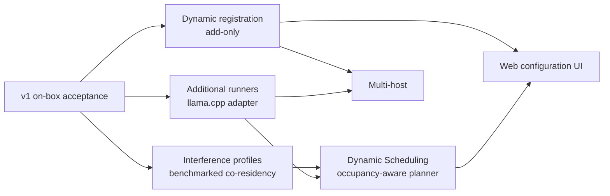

# vLLM Router — v2 Requirements

Status: **backlog, not scheduled.** Captured during v1 delivery so the
[v1 spec](../2026-07-28-pooling/spec.md) can freeze as the acceptance contract.
Prerequisite for everything here: v1 on-box acceptance on CT 107 is complete.
Decisions recorded here are binding on v2 design; everything else is draft.

Dependency shape:

## 1. Additional runners (llama.cpp first)

The v1 architecture already isolates runner specifics behind the `Runner` adapter
(commands, readiness probes, API capabilities, sleep/wake behavior); the pool manager
owns only generic resource and lifecycle concepts. v2 delivers the second adapter:

- llama.cpp server adapter: unit template, health/readiness probes, model verification,
  and its capability surface (no sleep mode; `--tensor-split` for placement — see §4).
- The service definition's `runner` field (already present in v1 config) selects the
  adapter; validation rules become runner-aware (e.g. vLLM-specific compatibility
  fields are rejected for llama.cpp services).
- GPU contention between runners is already handled generically by v1's
  declaration-based accounting; no new scheduling concepts are required for same-host
  mixed runners.

## 2. Dynamic service registration (add-only) — decided 2026-07-29

A later version will support *adding* a new service definition at runtime
(e.g. `POST /pool/v1/services`), enabling a web UI to make a new model available
alongside the existing inventory. Registration is purely additive — new map entries, a
new parking semaphore, a new placement participant — so it does not reopen the
stale-consumer invalidation class that motivated v1's immutable configuration. The
candidate definition must pass the same full validation as boot-time configuration,
merged against the live config, and unit generation plus `daemon-reload` must run
before the service becomes schedulable.

**Mutating or removing an existing definition stays restart-to-apply** (validated
restart / `-u` graceful upgrade); in-place mutation is explicitly out of scope at any
version. This dovetails with multi-host: service definitions become
control-plane-owned data with a single writer, not a file the process re-reads.

## 3. Web configuration UI

The consumer of §2. Two-stage delivery:

1. **Config-generator UI (no router changes):** writes the service block + `.env`
   file, runs `-t` validation, triggers the `-u` graceful upgrade. Works against v1
   as shipped; validates the UX cheaply. Requires host-level access — a different
   privilege tier than the `/pool` bearer token; design the trust boundary explicitly.
2. **Registration UI:** moves to `POST /pool/v1/services` once §2 lands.

A real "make a model available" flow is mostly orchestration above the router: weight
download (HF), disk-space checks against `/models`, quantization/TP selection that fits
a free GPU, and the sleep hardware-validation gate. Scope that separately from the
router work.

## 4. Dynamic Scheduling — decided 2026-07-29

**Dynamic Scheduling** is the router's continuous matching of model demand to GPU
supply: every automatic decision about *where, in what form, and whether* models run —
admission, placement and topology, eviction, idle tiering, replica scaling, and GPU
power stewardship. The name is deliberately broader than "Dynamic Deployment":
proactively draining an unused model or lowering an empty GPU's power state are
scheduling acts with no deployment involved. v1 shipped the reactive core (US1–US3,
US7); v2 extends it with the occupancy-aware ledger and planner below.

### Use-case catalog

| # | Scenario | Expected behavior | Status |
|---|---|---|---|
| **US1 — scale from zero** | request names a stopped/asleep model | park the request; single-flight start/wake; forward on ready; 503 + `Retry-After` past the parking deadline | v1 |
| **US2 — idle tiering** | no demand for the configured periods | running → asleep-L1 → asleep-L2 → stopped, per service policy; drain-first always | v1 |
| **US3 — demand eviction** | M3 fits GPU1 only if long-idle M1 leaves | drain M1 (never mid-request), stop, place M3, all while M3's request parks; victims by priority then LRU | v1 (min-idle guard: v1.x, §6) |
| **US4 — asymmetric packing** | M1 holds 20/32 GB on GPU1; M2 must span both GPUs; naive 50/50 would OOM GPU1 | per-GPU budgets from the ledger; runner-computed split (≤12 GB on GPU1); no overcommit | v2 |
| **US5 — budget reclamation** | under co-residency, M3 needs *part* of a GPU | evict the minimal eligible set to free budget; co-residents' pinned bindings untouched | v2 |
| **US6 — degraded topology** | M3 ideally fits one GPU; both are partially occupied | try declared placement profiles in preference order; accept the split profile only if all residents stay in memory; report degraded; self-heal at next start | v2 |
| **US7 — refusal** | a model cannot be placed while current residents stay | evict-or-503 with `Retry-After`; a model that can *never* fit is rejected at registration; overcommit is never permitted | v1 rule, v2 ledger |
| **US8 — replica scale-out/in** | one replica of M1 is saturated while a GPU sits free | start an additional replica through normal placement; least-inflight routing spreads load; the surplus replica retires later via US2 | v2 |
| **US9 — GPU power stewardship** | a GPU has no residents | let it reach deep idle / lower its power limit; restore before the next placement | v2 (verify NVML write perms in the LXC) |
| **US10 — predictive warm-up** | recurring demand patterns (e.g. weekday mornings) | optionally pre-wake models on schedule so the first request isn't cold | speculative, uncommitted |

### Mechanics

- **Budget ledger:** at placement time compute per-GPU free budget = capacity − awake
  reservations − sleep residuals, from the same declaration-based accounting v1 uses.
- **Deploy-time parameterization:** the service definition becomes a template; the
  router computes the per-GPU memory assignment and GPU selection at start time and
  renders them into the generated unit. A computed binding is pinned in the ledger for
  as long as the service is running *or asleep* (a woken vLLM re-grabs its original
  allocation).
- **Runner-declared split capability:** asymmetric fitting is runner-specific — vLLM TP
  is symmetric-only (uniform `gpu_memory_utilization`; verified no per-GPU cap), vLLM
  PP can split unevenly by layers (`VLLM_PP_LAYER_PARTITION`), llama.cpp
  (`--tensor-split`) and accelerate-style servers (`max_memory` per device) support
  arbitrary splits natively. The `Runner` adapter gains a planning hook ("given these
  per-GPU budgets, produce launch parameters or decline"); the pool stays generic.
- **Variable topology via declared placement profiles:** a service that can run in more
  than one shape (M3: ideally TP=1 on a single GPU; a two-GPU split when both GPUs are
  partially occupied) declares an *ordered* list of pre-validated placement profiles
  (parallelism, per-GPU VRAM requirement, compatibility limits such as maximum model
  length against the smaller KV budget) — the planner never invents topologies. It
  tries profiles in declared preference order, first non-destructively against the free
  ledger, then with eligible evictions; the first feasible profile wins, and "all
  residents stay in memory" is the existing no-overcommit invariant. Omitting profiles
  means the single fixed shape (v1 behavior). Notes: for vLLM TP a split profile's
  effective budget is `degree × min(free across chosen GPUs)`, not the aggregate
  (llama.cpp `--tensor-split` and accelerate-style runners do get the aggregate);
  per-profile cold-start cost differs (torch.compile caches per shape). A forced split
  is a *degraded* placement: report the active profile in status/metrics, and note it
  self-heals at the next lifecycle boundary — bindings recompute at every start, so an
  idle-stop→cold-start cycle or an explicit drain/stop/start re-optimizes placement
  without any configuration change.
- **Eviction as budget reclamation:** under co-residency, evicting a service frees its
  *budget*, not a whole GPU. The victim planner must find the minimal-cost eligible set
  whose reclaimed budgets (including slept residuals) make the candidate placement
  feasible, without touching pinned allocations of non-victims — e.g. M3 fits GPU1 only
  if long-idle M1 is drained off it, while co-resident M2's binding is untouched.
  Cost ordering remains priority, then least-recently-used, and drain-first semantics
  are unchanged: victims are drained, never killed mid-request.
- **Refusal:** a model that fits the inventory but not the *current* free budget gets
  the existing evict-or-503 treatment (`Retry-After`); a model that can never fit the
  inventory is rejected at registration/validation time. No placement may overcommit.
- **Replica scale-out/in (US8):** the v1 data plane already routes least-inflight
  across every ready replica of a served model; v2 adds the control side — a scale
  policy (e.g. sustained inflight-per-replica above a threshold) that starts an
  additional replica through normal placement and lets idle tiering retire it.
  Replicas are additive service instances, consistent with add-only registration (§2).
- **GPU power stewardship (US9):** lifecycle tiers are already the largest power lever —
  a stopped service releases its CUDA context and lets the GPU reach deep idle, while
  slept services hold residual context and a higher power floor. v2 may additionally
  lower an empty GPU's power limit via NVML and restore it before the next placement.
  NVML power-limit writes need root and may not be permitted from the unprivileged
  LXC — verify on CT 107 before committing to this mechanism; measure the actual
  watt delta per tier while running the interference profiles.
- **Isolation caveat:** memory fit is not performance isolation; consumer Blackwell has
  no MIG. Enabling awake co-residency requires benchmarked interference profiles (the
  v1 resolutions' precondition) plus a per-service latency-priority signal to bias
  packing decisions.

## 5. Multi-host

The v1 `PoolManager` trait is the cut line: the pool module becomes a per-host agent
daemon; the trait implementation in the router becomes a client; the data-plane routing
contract is unchanged. Deferred with it from v1: mTLS between router and agents
(replacing the single-host bearer token for the control path), cross-host placement,
and health aggregation across agents. Distributed scheduling/consensus remains out of
scope until a concrete need exists.

## 6. Smaller carried items

Eligible for a v1.x patch rather than v2 if convenient:

- **Minimum-idle eviction guard** (`min_idle_before_eviction`, per service): v1
  demand-driven eviction treats *instantaneous* idleness as eligibility, so a service
  whose request stream has a momentary gap can be evicted and immediately need a
  multi-minute cold start back (thrash between alternating models). A service should
  become a demand-eviction candidate only after an agreed idle period; `idle_for`
  stays the LRU tie-breaker. Small change (one eligibility condition + config field),
  meaningful protection.
- **Dialect-aware router error envelopes** (review-2 CO2): router-generated errors on
  `/v1/messages` should use Anthropic's error shape; Cohere-style endpoints likewise.
- **Multipart model extraction** so audio transcription/translation endpoints become
  routable.
- **Configurable runner executable path** (review-2 N2): `VLLM_EXECUTABLE` is
  hardcoded to `/opt/vllm-venv/bin/vllm` in the unit generator.
- **Trusted model-routing header** (v1 resolution deferred it): optional signed header
  to skip body parsing for clients we control; body validation stays authoritative
  upstream.
- **Multi-LoRA**, if ever added, is modeled separately from base-model lifecycle and
  GPU placement (carried from the v1 scope note).
